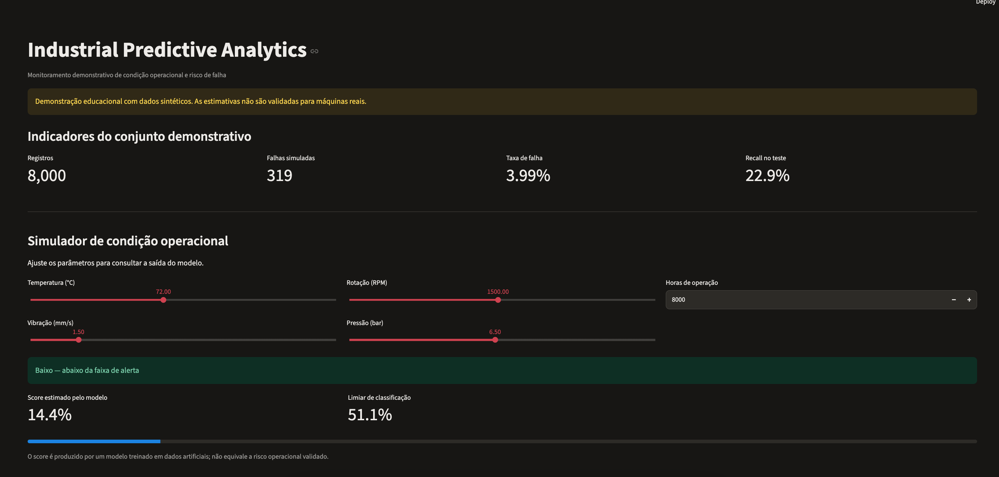

# Industrial Predictive Maintenance | Machine Learning

A data science project focused on predictive maintenance, operational data analysis and machine learning applied to industrial equipment.

## Project Overview

This solution uses machine learning techniques to analyze industrial operating parameters and estimate equipment failure risk.

## Technologies

- Python
- Pandas & NumPy
- Scikit-learn
- Random Forest
- Streamlit
- Matplotlib

## Key Features

- Synthetic industrial dataset generation
- Data analysis and preprocessing
- Predictive modeling with Random Forest
- Model evaluation and performance metrics
- Interactive monitoring dashboard
- Feature importance analysis
- Failure risk estimation

## Dataset

The project uses 8,000 synthetically generated records containing:

- Temperature
- Vibration
- RPM
- Pressure
- Operating hours
- Failure indicator

**Note:** The dataset is synthetic and intended exclusively for educational and demonstration purposes.

## Running the Project

```bash
pip install -r requirements.txt
python3 src/generate_data.py
python3 src/train.py
python3 -m streamlit run src/dashboard.py
```

## Project Structure

```text
industrial-predictive-maintenance/
├── data/
├── models/
├── reports/
├── src/
│   ├── generate_data.py
│   ├── train.py
│   └── dashboard.py
├── README.md
└── requirements.txt
```

## Author

Data Science | Python | Machine Learning | Industrial Analytics

## Dashboard Preview


